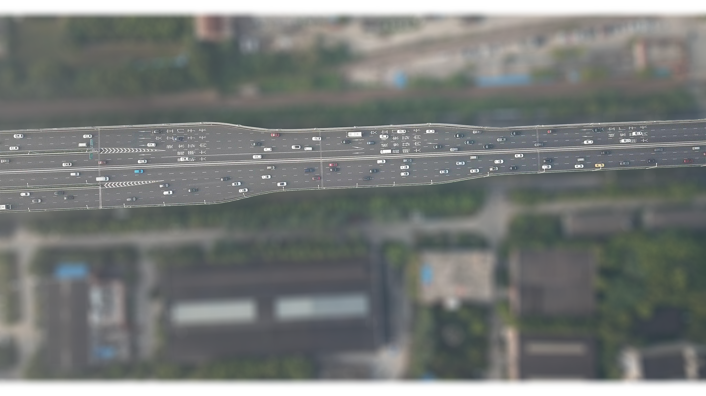
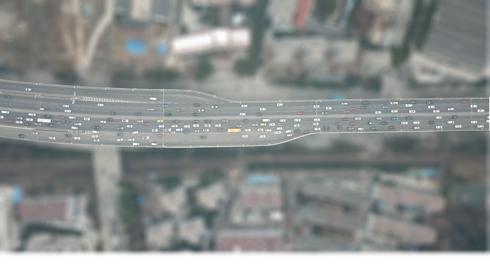
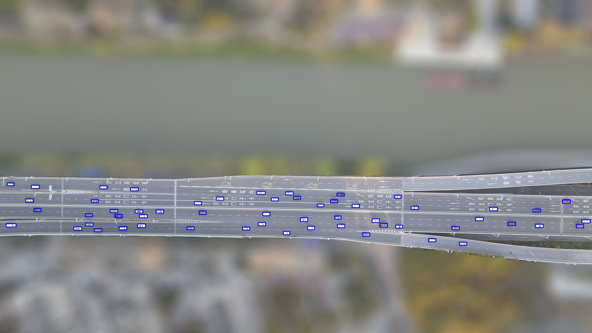
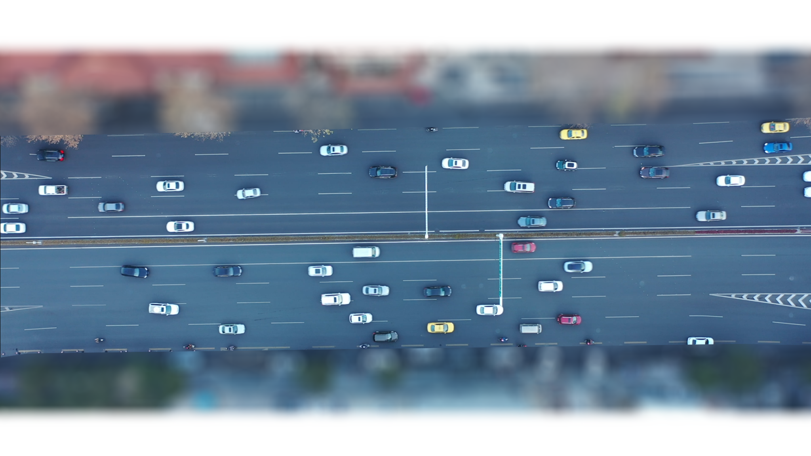
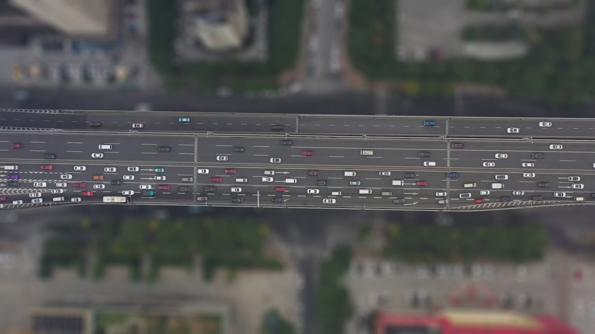
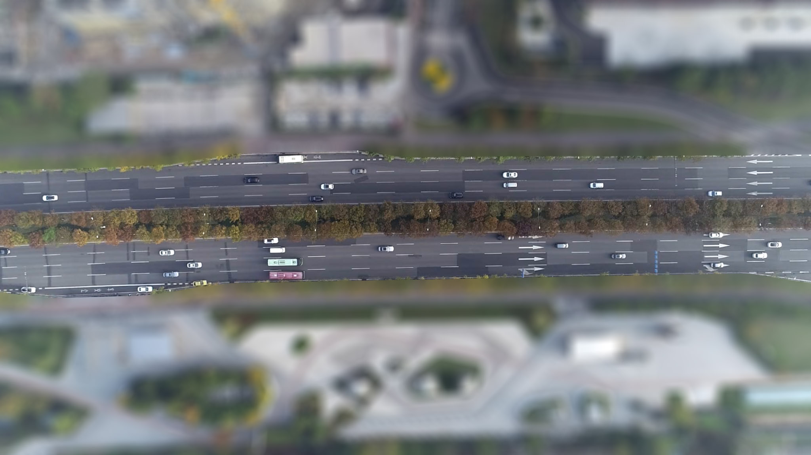
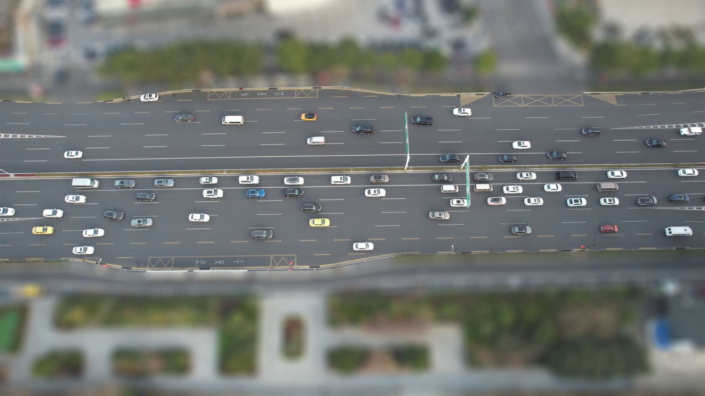

  
  <h1 style="margin: 0;">Ubiquitous Traffic Eye</h1>

## Trajectory Data Introduction
Vehicle trajectory data provides critical information for traffic flow modeling and analysis during different traffic states and state transitions.  
This dataset — **Ubiquitous Traffic Eyes (UTE)** — is based on aerial UAV videos. It contains **high-resolution vehicle trajectories automatically extracted** from UAV footage, addressing challenges such as pixel shake, vehicle detection, and trajectory fragment reconstruction.

To bridge the gap in available data for **traffic transition conditions**, UTE captures data from **typical state transition periods and fixed bottleneck locations**, such as weaving and merge/diverge areas.  
The current dataset includes data from **seven distinct locations**, covering **freeway basic segments, merge/diverge segments, and weaving segments**. It presents vehicle trajectories under **free flow, congested, and transition traffic states**, enabling a comprehensive analysis of how traffic evolves and adapts, especially in regions characterized by frequent maneuvers.

These datasets include **large quantities of vehicle trajectories** collected at multiple sites and during different time periods.  
The data are extracted from aerial videos, with manual quality checks to ensure accuracy.

Each dataset corresponds to a **specific site and time period**, covering various traffic states.  
The dataset includes:
- UAV aerial video files with object bounding boxes  
- Raw trajectory data  
- Data format descriptions  

The original trajectory data contain:
- Vehicle ID, position coordinates, lane number  
- Vehicle length and width  
- Speed, time headway, space headway  
- Acceleration/deceleration information  
- **Temporal resolution:** 0.1 s  
- **Spatial resolution:** 0.01 m

---

## 📍 Data Collection Sites

| Site            | Segment Length (m) | Location Type          | Coordinates (Lat, Lon)       | Speed Limit (Km/h) | Traffic Conditions                                                                                 |
|-----------------|--------------------|-------------------------|------------------------------|--------------------|-----------------------------------------------------------------------------------------------------|
| Expressway 1 (SQM)   | 386                | Merge/Diverge Segment  | 32.005548, 118.789275        | 80                 | From free-flow to congestion in morning peak hours, with obvious stop-and-go waves.                 |
| Expressway 2 (YTAvenue)   | 362                | Merge/Diverge Segment  | 32.005887, 118.781899        | 80                 | Congested traffic in morning peak hours, with obvious stop-and-go waves.                            |
| Expressway 3 (CKQ)   | 352                | Weaving Segment       | 32.010155, 118.796739        | 80                 | Unimpeded traffic.                                                                                 |
| Expressway 4 (RML)   | 220                | Merge Segment         | 28.182147, 113.017548        | 80                 | Unimpeded traffic to congestion.                                                                    |
| Urban Road 1 (XAM-N)   | 140                | Weaving Segment       | 32.053866, 118.807840        | 60                 | From free-flow to congestion in afternoon peak hours, with obvious stop-and-go waves.              |
| Urban Road 2 (PKDD)   | 280                | Basic Segment         | 32.067824, 118.664783        | 80                 | Free flow.                                                                                          |
| Urban Road 3 (XAM-S)   | 220                | Weaving Segment       | 32.037338, 118.803662        | 60                 | Free flow to congestion in afternoon peak hours, with obvious stop-and-go waves.                    |

---

## 📦 Section Information

| Section ID              | Length (m) | Duration (s) | Trajectories | Lane Layout |
|-------------------------|------------|-------------|-------------|------------|
| Expressway 1 (SQM1)     | 427        | 255         | 1041        | 5×2        |
| Expressway 1 (SQM2)     | 386        | 400         | 1420        | 5×1        |
| Expressway 2 (YTAvenue3)| 362        | 545         | 1072        | 5×2        |
| Expressway 3 (CKQ4)     | 352        | 1184        | 2513        | 5×2        |
| Urban Road 1 (XAM-N5)   | 140        | 264         | 862         | 5×2        |
| Urban Road 1 (XAM-N6)   | 140        | 366         | 900         | 5×2        |
| Expressway 4 (RML7)     | 220        | 300         | 555         | 4×1        |
| Urban Road 2 (PKDD8)    | 280        | 1066        | 1477        | 4×2        |
| Urban Road 3 (XAM-S9)   | 180        | 300         | 463         | 6×1        |

---

## 📥 Download the Data

[<b>SQM</b> ](https://github.com/Ruyi-Feng/Ubiquitous-Traffic-Eye/tree/UTE/datasets/SQM) [SQM-W-1](https://github.com/Ruyi-Feng/Ubiquitous-Traffic-Eye/tree/UTE/datasets/SQM/SQM-W-1) [SQM-W-2](https://github.com/Ruyi-Feng/Ubiquitous-Traffic-Eye/tree/UTE/datasets/SQM/SQM-W-2)  |  [<b>YTDJ</b> YTDJ-3](https://github.com/Ruyi-Feng/Ubiquitous-Traffic-Eye/tree/UTE/datasets/YTDJ/YTDJ-3)
:-------------------------:|:-------------------------:
 | 
[<b>CKQ</b> SQM-N-4](https://github.com/Ruyi-Feng/Ubiquitous-Traffic-Eye/tree/UTE/datasets/CKQ/SQM-N-4) | [<b>XAM-N</b> XAM-N-5 / XAM-N-6](https://github.com/Ruyi-Feng/Ubiquitous-Traffic-Eye/tree/UTE/datasets/XAM-N)
 | 
| [<b>RML</b> RML-7](https://github.com/Ruyi-Feng/Ubiquitous-Traffic-Eye/tree/UTE/datasets/RML/RML-7) | [<b>PKDD</b> PKDD-8](https://github.com/Ruyi-Feng/Ubiquitous-Traffic-Eye/tree/UTE/datasets/PKDD/PKDD-8)
 | 
| [<b>XAM-S</b> XAM-S-9](https://github.com/Ruyi-Feng/Ubiquitous-Traffic-Eye/tree/UTE/datasets/XAM-S/XAM-S-9) | 
 |

---

## 📚 Learn More About Our Work

UTE only includes the core data we collected.  
For more information, related research, and publications, please visit:  
👉 [http://seutraffic.com/#/](http://seutraffic.com/#/)

If you use the dataset, please cite our paper:  
> Feng, R., Zhu, H., Sze, N. N., Wang, S., & Li, Z. (2025). *Ubiquitous Traffic Eyes: trajectory dataset focus on multiple traffic states and state transition on urban expressways.* Transportation Letters, 1–17.

---